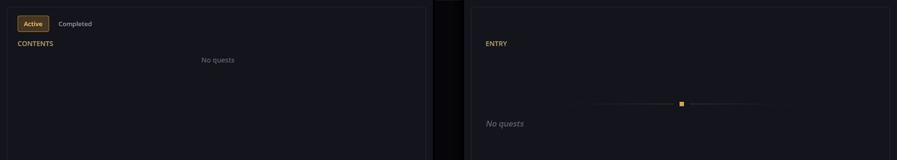
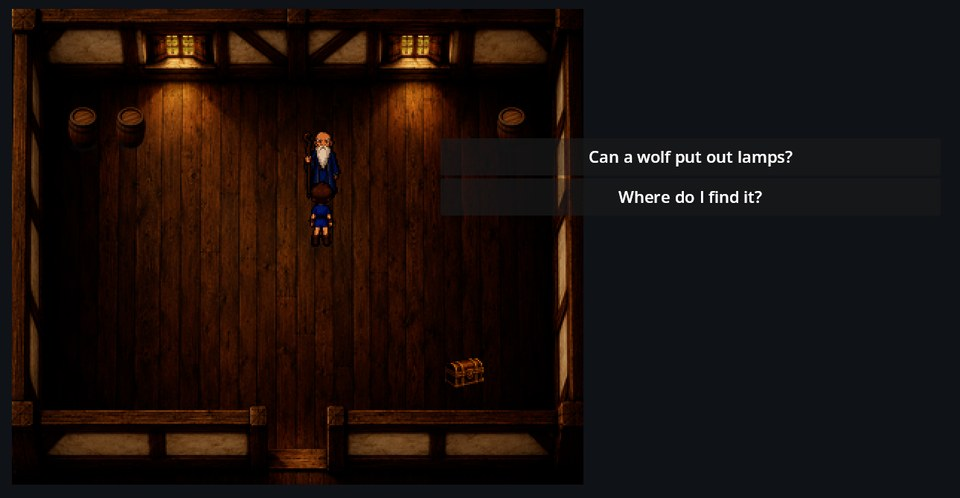
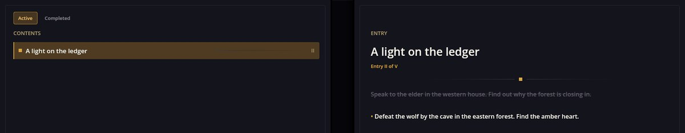

# Quests Engine — クエスト、そのステップ、ジャーナル

Quests Engine はプレイヤーのタスクを管理します。クエストには名前と番号付きのステップ一覧があり、シナリオがクエストを開始し、次のステップへ進め、タグを付け、完了させます。**ジャーナル**パネルにはプレイヤーが受けたクエストが表示され、その状態はゲームのセーブに保存されます。

Cthangover（プロローグの目覚めと古い家）と RPG Plus（森のクエスト）がこれを使っています。

## ジャーナル

ツールバーのジャーナル・アイコンで開きます。プレイヤーがまだクエストを一つも受けていなければ、空です。



RPG Plus では村の長老が最初のクエストを出します。どこへ探しに行けばいいか尋ねてみましょう。



答えると、クエストがジャーナルに現れます。



- **進行中**には進行中のクエスト、**完了**には終わったクエストが並びます。まだ始めていないクエストは決して表示されません。
- 右のページには選んだクエストが出ます。済んだステップには打ち消し線、現在のステップには印が付き、先のステップは隠れたまま。ジャーナルが物語を先にばらすことはありません。
- クエストが獲得したタグは、項目の下に小さな金色の札として表示されます。

## クエストの定義

クエストは、mod の `quests/` フォルダーに入る kind `quest` の JSON ファイルです。こちらは画像のクエスト（RPG Plus のもの）です。

```json
{
  "Kind": "quest",
  "Items": [
    {
      "Id": "woodland_ward",
      "Name": "rpg_plus/quest/ward/name",
      "StatusToDescription": {
        "0": "rpg_plus/quest/ward/0",
        "1": "rpg_plus/quest/ward/1",
        "2": "rpg_plus/quest/ward/2",
        "3": "rpg_plus/quest/ward/3",
        "4": "rpg_plus/quest/ward/4"
      }
    }
  ]
}
```

`Name` と各ステップは翻訳キーです。番号がクエストの**ステップ**になります。ステップ 1 では `1` のテキストが現在のステップとして表示され、`0` には打ち消し線が付きます。画像でいう「項目 II / V」です。

## シナリオからクエストを進める

RPG Plus で長老の答えがクエストを開始し、ステップ 1 に置きます。

```scenario
action quest.set_status quest_id=woodland_ward status=Progress
action quest.set_data_status quest_id=woodland_ward level=1
```

- `quest.set_status` — クエストの状態。`NotStarted`、`Progress`（進行中）、`End`（完了）。
- `quest.set_data_status` — 現在のステップ。`level` がその番号です。
- `quest.add_tag` / `quest.remove_tag` と `tag=…` — 起こったことを記録します。たとえばプレイヤーがどのアイテムを先に取ったか。
- `quest.send_notification` — クエストについての通知をプレイヤーに表示します。クエストを変えただけでは通知は出ません。

## クエストの確認

クエストの判定は、ゲームが条件を受け付ける場所ならどこでも機能します。`when`、選択肢の条件、シーンの条件、マップイベントです。

```scenario
when "woodland_ward.DataStatus >= 2" -> :lantern
```

- `<quest>.IsActive` — クエストが進行中。
- `<quest>.Status` — `0` 未開始、`1` 進行中、`2` 完了。
- `<quest>.DataStatus` — 現在のステップ。
- `<quest>.hasTag("tag")`、`<quest>.notHasTag("tag")` — Cthangover はこれでシーンのどのシナリオを再生するか決めます。例は `AwakeningQuest.hasTag("book_taken")`。

## うまく動かないとき

1. **クエストがジャーナルに出ない。** 状態が `Progress`（完了タブに出すなら `End`）である必要があります。ステップだけ設定しても足りません。
2. **ジャーナルがテキストではなくキーを表示する。** ステップのキーを mod の `locale` ファイルに追加してください。
3. **条件が常に偽になる。** クエスト id のつづりがクエストファイルの `Id` と違います。ログには未知のクエストの警告が出ます。
